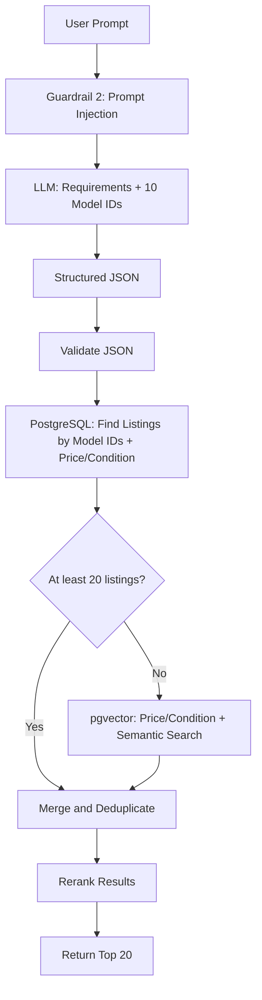

# RAG

The search module `modules/rag`. It is used by the Search page ([SEARCH_PAGE.md](../features/SEARCH_PAGE.md)) and by listing create, update and delete ([MY_LISTING.md](../features/MY_LISTING.md)).

## Architecture

**RAG Type:** Hybrid RAG.

1. Each phone model is identified by its model code: see [Model code](#model-code).
2. The LLM returns the top 10 models that match the query (`A2483`, `SM-S911U`, `SM-G998U`, etc.).
3. The listings for these models are retrieved from the database. Condition and price from the prompt are applied in the same SQL query.
4. If there are not enough phones for the results (20 results), for example, if only 2 of the 10 models exist in the database, a vector search query (pgvector) supplements the results. Condition and price from the prompt are applied in the same SQL query.
5. The results are merged, deduplicated by `phone_id` and reranked once: see [RERANKING.md](RERANKING.md).



## Orchestration: LangGraph

The search pipeline is implemented as a LangGraph graph. The pipeline is not a linear chain: it has a condition (fewer than 20 results leads to vector search). Why LangGraph: see [Tradeoffs](#langgraph).

## LLM Output Structure

Fields under `filters` are present only if the user set them in the prompt.

```json
{
  "filters": {
    "condition": {
      "value": ["like_new", "average"]
    },
    "price": {
      "operator": "<=",
      "value": 300,
      "unit": "USD"
    }
  },
  "preferences": {
    "os": {
      "value": "android"
    },
    "camera_megapixels": {
      "operator": ">=",
      "value": 50
    },
    "battery_capacity": {
      "operator": ">=",
      "value": 5000
    },
    "display_size": {
      "operator": ">=",
      "value": 6.1
    }
  },
  "model_ids": ["A2483", "SM-S911U"],
  "query_for_embedding": "Android smartphone with a high-quality camera, long battery life, and a large display"
}
```

## Model code

The model code is the key that links a listing to the search. The phone name may be written with different capitalization or in different formats, the code is the same: see [Tradeoffs](#model-code-instead-of-the-model-name).

### v1.0 (PoC)

- When the listing description is generated, OpenAI also returns the model code: see [MY_LISTING.md](../features/MY_LISTING.md#add-phone-flow).
- Only one code is used: the US version of the model (the market is the US only, see [TASK.md](../TASK.md#product)). For example, iPhone 13 Pro: `A2483`.
- In search, the LLM returns model codes by the same rule, and listings are found by exact match of the code.

## Storage

Search is a separate layer owned by `modules/rag`. In v1.0 the index is stored in PostgreSQL (Supabase) with the pgvector extension. Why pgvector: see [Tradeoffs](#pgvector-vs-a-dedicated-search-engine).

### Search index table

The `search_index` table is the read model for search: see [SCHEMAS.md](../backend/SCHEMAS.md#search_index-modulesrag).

- One SQL query combines vector similarity with condition and price when they are set in the prompt: `WHERE condition = ANY(...) AND price <= ... ORDER BY embedding <=> :query LIMIT 20`. Conditions that are not set are not added to `WHERE`.

### Indexing

- Create, update and delete of a listing change `phones` and `search_index` in one transaction. The index cannot get out of sync with the data.
- On update, the embedding is regenerated only if the model name, description or condition note changed. Price, condition and specification changes update the copied fields only.
- The embedding is generated synchronously in the request, there is no background task.
- The embedding input: `model_name`, `description` and `condition_note`, joined by new lines.

### Module interface

Other modules use search only through the `modules/rag` interface. The storage behind the interface is an implementation detail.

- `embed_listing(model_name, description, condition_note)`: the embedding of the listing text. A slow network call, made before the transaction of the listing.
- `index(session, phone, embedding)`: creates the search index record. `session` is the transaction of the listing: [Indexing](#indexing). `phone` holds the copied listing fields. `embedding` is the result of `embed_listing`, so a retried transaction does not call the embeddings API again: see [DESIGN.md](../backend/DESIGN.md#transaction-retry).
- `delete(phone_id)`, `search(query, filters)`.

## Errors and Retries

Each kind of error is retried in one place only: see [Tradeoffs](#retries-in-one-place).

1. Network and provider errors of the LLM and embeddings API (timeout, HTTP 429, HTTP 5xx): the built-in retry of the LangChain model client, `max_retries=2` with exponential backoff.
2. The LLM response fails Pydantic validation: one repeated call of the LLM node (LangGraph `RetryPolicy`, 2 attempts in total). The node policy retries validation errors only. The LLM calls of `modules/phones` (description generation, Guardrail 1) repeat the call once by the same rule, without LangGraph.
3. Transient database errors of the listing and search index transaction: one repeated transaction, see [DESIGN.md](../backend/DESIGN.md#transaction-retry).

Reranking errors do not fail the search: see [RERANKING.md](RERANKING.md#errors). If the retries of the other nodes fail, `POST /api/search` returns HTTP 503 and the error is logged: see [EVALUATION.md](EVALUATION.md). The Search page shows the error message: see [SEARCH_PAGE.md](../features/SEARCH_PAGE.md#errors).

## Tradeoffs

### LangGraph

- The graph in the code matches the diagram in [Architecture](#architecture), one node per step.
- The state between the steps is explicit: the parsed filters and preferences, the model codes, the found listings.
- `RetryPolicy` is set per node, for example only on the LLM node.
- Each node is traced in LangSmith without additional code: see [EVALUATION.md](EVALUATION.md).

Not used:

- A self-evaluation node (corrective RAG: the LLM grades the retrieved listings and rewrites the query). It adds an LLM call to every search, with extra latency and cost. Reranking covers this role in v1.0.
- LangGraph is not an evaluation tool. Evaluation: see [EVALUATION.md](EVALUATION.md).

### Model code instead of the model name

One model can be written in many ways. Example for iPhone 15 Pro Max:

- `iPhone 15 Pro Max`
- `Apple iPhone 15 Pro Max`
- `iphone 15 max pro`
- `iPhone15ProMax`
- `15 pro max`

The problem appears on both sides:

- The seller enters the model name in any form. The LLM can also return the name in different forms for the same model.
- In search, the LLM returns the models that match the prompt, but it does not know which form of the name is stored in the database.

Matching by name is unreliable. The model code is one value for all forms of the name: iPhone 15 Pro Max is `A2849` (US version) in the listing and in the search.

### Model code limitations

- A model can have several codes, including several US codes (for example, Samsung Galaxy S23: `SM-S911U` and `SM-S911U1`). If the code from the search differs from the code saved with the listing, the listing is not found at the model code step.
- Model codes are returned by the LLM. Errors are possible for rare models.
- Vector search and reranking partly compensate for these errors.

### Production: model catalog

A model catalog replaces the model code from the LLM.

- The catalog stores each phone model with all its codes: all regions and variants (for example, `SM-S911U` and `SM-S911U1` belong to one model).
- A listing references the model by the catalog `id`. The model is selected from the catalog when the listing is created, the LLM does not define it.
- In search, the LLM result is mapped to the catalog, and listings are found only by the catalog `id`.
- The catalog is filled and maintained separately from the listings.

### pgvector vs a dedicated search engine

- PostgreSQL is already used, no extra service, keys or limits.
- Hybrid search (condition, price and vector similarity) is one SQL query.
- One transaction for the listing and its index: no consistency problem between two stores, no reindex job.
- The v1.0 volume (thousands of listings) is well within pgvector capacity.

A dedicated search engine (Pinecone, Elasticsearch) was considered and postponed. Its advantages (isolation of search load, very large volumes) are not needed in v1.0. Migration does not change code outside `modules/rag`: see [ROADMAP.md](../ROADMAP.md#high-load).

### Retries in one place

Network errors are retried by the model client, validation errors by the LangGraph node. If both levels retried the same errors, the attempts would multiply (3 x 3 = 9 calls), and the user would wait too long for an error message.
